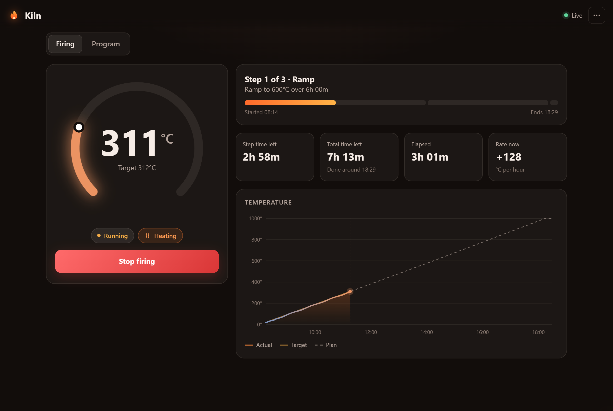
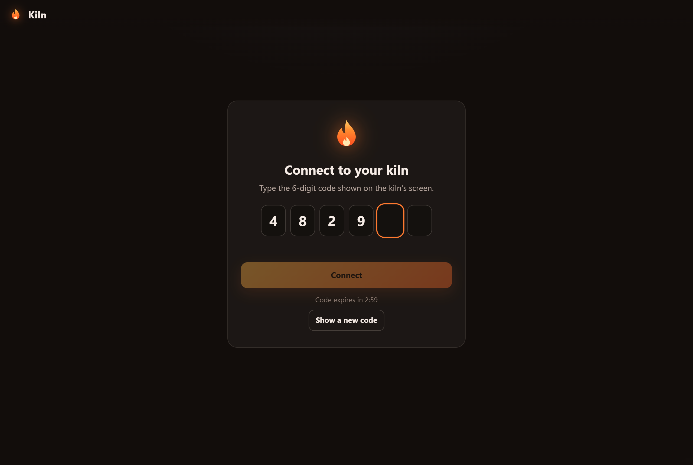
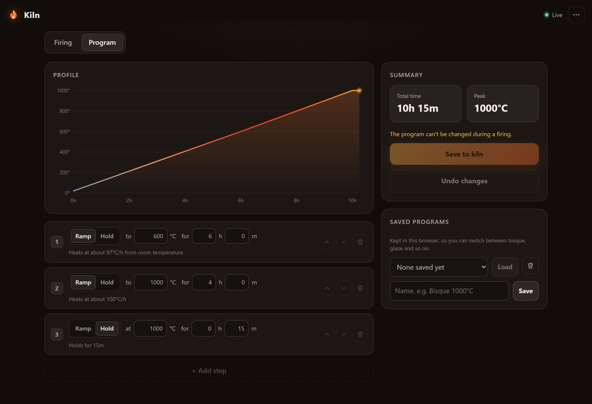
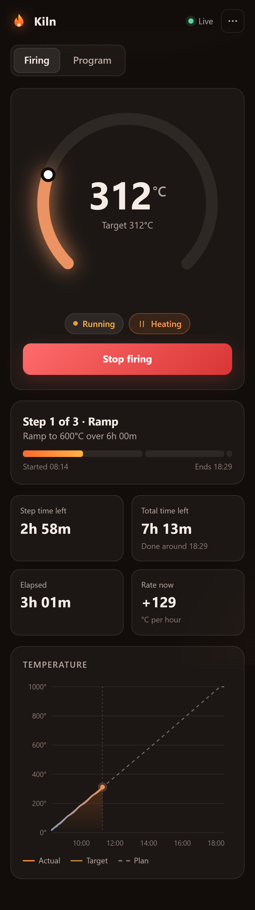

# Programmable Kiln

A controller for an electric kiln: an Arduino UNO R4 WiFi switches the elements through a
solid-state relay, a Nextion touch screen runs it at the kiln, and a web page lets you
watch and program a firing from your phone or computer.



## Hardware

| Part | Connection |
| --- | --- |
| Arduino UNO R4 WiFi | |
| MAX31855 thermocouple board | CLK → D13, CS → D10, DO → D12 |
| K-type thermocouple | MAX31855 + / − |
| Solid-state relay (heater) | D3 → SSR input |
| Nextion display | Serial1 (D0/D1), 9600 baud |

> **Mains voltage.** The kiln elements run from mains through the SSR. Get the wiring
> checked by someone qualified, and fit a contactor or thermal fuse that cuts power
> independently of the Arduino.

## Repository layout

| Path | What it is |
| --- | --- |
| `KilnController/` | Arduino sketch (open `KilnController.ino` in the Arduino IDE) |
| `KilnController/web/` | React web UI, built into `KilnController/webpage.h` |
| `nextion/` | Nextion Editor project (`Kiln.HMI`), fonts and the compiled `Kiln.tft` |
| `docs/screenshots/` | Screenshots of the web UI |

## Building

1. Install the Arduino IDE with the **Arduino UNO R4 Boards** package and the
   **Adafruit MAX31855** library.
2. Copy `KilnController/arduino_secrets.example.h` to `KilnController/arduino_secrets.h`
   and fill in your WiFi name and password. The real file is ignored by git.
3. Open `KilnController/KilnController.ino` and upload it.
4. Copy `nextion/Kiln.tft` to a microSD card and power the screen up with the card in to
   load it. To change the screens, open `nextion/Kiln.HMI` in Nextion Editor.

## Firing programs

A program is up to 20 steps, saved in EEPROM so it survives a power cut.

- **Ramp** moves the target temperature in a straight line from where the step started
  to the step's temperature over its duration.
- **Hold** keeps the target at the step's temperature for its duration.

The heater is switched on whenever the kiln is below the current target.

## Safety checks

The heater is turned off and the kiln goes into **Fault** until Stop is pressed if:

| Check | Limit |
| --- | --- |
| Over temperature | above 1300 °C |
| Thermocouple errors | 3 bad readings in a row |
| No temperature rise | heater on for 10 minutes and less than 5 °C rise |
| Rising while off | heater off for 10 minutes and more than 30 °C rise (stuck relay) |
| Firing too long | over 24 hours |

A 5-second watchdog resets the board, with the heater off, if the code ever hangs.
Limits are constants at the top of `KilnController.ino`.

## Screen commands

The Nextion pages send newline-terminated commands over Serial1. The same commands can be
typed into the Serial Monitor for testing.

| Command | Meaning |
| --- | --- |
| `START` / `STOP` | Start the program / stop and clear a fault |
| `PAGE,<name>` | The screen changed to page `Run`, `Program` or `Edit` |
| `SEL,<row>` | Select a step row on the Program page |
| `SCROLLUP` / `SCROLLDN` | Scroll the step list |
| `ADD` / `EDIT` | Open the Edit page for a new or the selected step |
| `SAVE,<type>,<temp>,<mins>` | Save the step from the Edit page (type 0 ramp, 1 hold) |
| `DEL` / `MOVEUP` / `MOVEDN` | Delete or move the selected step |
| `FORGETWEB` | (Serial Monitor) unpair every web browser |

The program can't be changed while a firing is running.

## Web control

When the board joins your WiFi, the Run page shows its address (e.g. `Web 192.168.1.50`)
while the kiln is idle. Open that address in a browser on the same network.



**Connecting a browser:** press **Show code on kiln**, then type the 6-digit code the kiln
shows on its screen. The code lasts 3 minutes and five wrong guesses cancel it. Up to four
browsers can be connected; type `FORGETWEB` in the Serial Monitor to disconnect them all.

The web page shows the live temperature, the current step, time left, the heating rate and
a chart of the firing against the plan. The Program tab edits the program and can keep
named programs (bisque, glaze, …) in the browser.

| Program editor | On a phone |
| --- | --- |
|  |  |

### API

All endpoints except the page and pairing need the `X-Kiln-Token` header.

| Endpoint | |
| --- | --- |
| `GET /` | The web page (gzipped, from `webpage.h`) |
| `POST /api/pair/start` | Show a pairing code on the screen |
| `POST /api/pair` | Body: the code. Returns `{ "token": "…" }` |
| `GET /api/status` | Temperature, state, step, setpoint, time left |
| `GET /api/program` | `{ "version", "steps": [[type, temp, mins], …] }` |
| `POST /api/program` | Body: `type,temp,mins;type,temp,mins;…` replaces the program |
| `GET /api/history` | One sample a minute for up to 24 hours |
| `POST /api/start` / `POST /api/stop` | Start or stop a firing |
| `POST /api/unpair` | Forget this browser |

### Working on the web UI

```powershell
cd KilnController/web
npm install
npm run mock      # pretend kiln on http://localhost:8080 (prints the pairing code)
npm run dev       # live-reloading UI on http://localhost:5173
```

`$env:DEMO = "1"` before `npm run mock` starts the pretend kiln partway through a firing.
To use a real kiln instead, set `$env:KILN = "http://<kiln address>"` before `npm run dev`.

When you're happy, rebuild the page that the sketch serves and upload the sketch again:

```powershell
powershell -ExecutionPolicy Bypass -File KilnController/web/build.ps1
```
